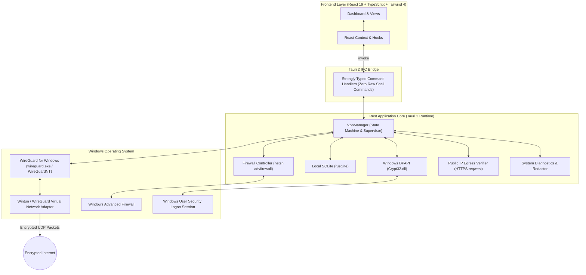

<div align="center">

  

  # Private VPN
  
  **Next-Generation, Zero-Telemetry WireGuard® Desktop Client for Windows**

  [](https://www.rust-lang.org/)
  [](https://tauri.app/)
  [](https://react.dev/)
  [](https://www.typescriptlang.org/)
  [](https://tailwindcss.com/)
  [](https://microsoft.com/windows)
  [](LICENSE)

  <p align="center">
    <a href="#key-features">Key Features</a> •
    <a href="#application-tour">Application Tour</a> •
    <a href="#architecture">Architecture</a> •
    <a href="#prerequisites">Prerequisites</a> •
    <a href="#quick-start">Quick Start</a> •
    <a href="#importing-wireguard-configurations">Configuration Guide</a> •
    <a href="#security--privacy">Security & Privacy</a> •
    <a href="#troubleshooting">Troubleshooting</a>
  </p>

</div>

---

> [!IMPORTANT]
> **Active WireGuard Configuration Required for Internet Access**
> 
> Private VPN is a client engine that establishes encrypted tunnels using the official **WireGuard for Windows** kernel service. The default entries (`[Sample Demo] US East`, `[Sample Demo] EU Central`, `[Sample Demo] CH Secure Core`) are **non-routable documentation templates** (`198.51.100.x` test subnets) shipped to illustrate the dashboard interface.
> 
> To route live encrypted traffic and change your public IP address, import an active `.conf` file from your VPN provider (e.g., Proton VPN, Cloudflare WARP, Mullvad, or a self-hosted VPS) using the **Import WireGuard Config** button in the **Locations** tab.

---

## Overview

**Private VPN** is a modern, high-performance desktop VPN client engineered specifically for Windows 10 and Windows 11 (64-bit). Built from the ground up with **Tauri 2**, **Rust**, and **React 19**, it bridges high-speed kernel-level WireGuard tunneling with a native Windows defense-in-depth architecture.

Unlike traditional Electron-based VPN clients that consume hundreds of megabytes of RAM and run privileged shell scripts, Private VPN employs a lightweight memory-safe Rust backend, Windows Data Protection API (DPAPI) hardware-backed key encryption, dynamic Windows Advanced Firewall rule enforcement, and an intelligent handshake auto-disconnect fail-safe.

---

## Key Features

### ⚡ Wire-Speed Kernel Tunneling
- **WireGuardNT Integration**: Direct interface with the official WireGuard for Windows engine (`wireguard.exe` / `wireguard.dll` service) for native Wintun / WireGuardNT kernel performance.
- **Handshake Auto-Disconnect Fail-Safe**: A background supervisor monitors tunnel handshakes. If a remote server is offline, down, or fails to complete the WireGuard cryptographic handshake, Private VPN automatically tears down the tunnel, preventing blackholed traffic and Windows "No Internet access" adapter hangs.
- **Multi-Source Egress IP Verification**: Concurrently queries independent HTTPS egress detectors (`ipwho.is`, `api64.ipify.org`, `icanhazip.com`) to confirm that your public IP, ISP, and geolocation have changed after establishing a connection.

### 🛡️ Ironclad Security & Cryptography
- **Hardware-Backed Credential Vault (Windows DPAPI)**: Client private keys (`PrivateKey`) and pre-shared keys (`PresharedKey`) are encrypted at rest using the Win32 `CryptProtectData` API, bound to the user's active Windows security logon session. Sensitive private keys are never stored in plaintext and are never exposed to the frontend webview.
- **Native Windows Firewall Kill Switch**: Employs stateful `netsh advfirewall` outbound filtering rules (`PrivateVPN-KillSwitch-*`) that block all non-tunnel outbound internet traffic while preserving LAN connectivity for local routers and printers.
- **DNS & IPv6 Leak Prevention**: Configures tunnel-assigned DNS resolvers directly on the virtual interface and enforces an outbound IPv6 firewall block to prevent dual-stack leakage.
- **Redacted Diagnostics**: Built-in debug logging automatically scrubs cryptographic secrets, base64 private keys, and user tokens through regex-driven sanitization routines.

### 💻 Modern User Experience
- **Fluid React 19 & Tailwind 4 UI**: Styled with a dark cybersecurity-inspired palette (navy `#0B0F19`, charcoal, cyan, and emerald accents) with support for responsive layouts and light mode.
- **Zero-Telemetry Local Database**: Uses an embedded SQLite database (`%LOCALAPPDATA%\PrivateVPN\private_vpn.db`) via `rusqlite` to store server profiles, application preferences, and session statistics. No telemetry, analytics, or browsing histories are ever collected or transmitted.
- **Integrated Config Importer**: Import standard `.conf` files via drag-and-drop or raw text paste with immediate client/peer validation.

---

## Application Tour

Private VPN organizes network and privacy management into 6 dedicated screens:

| View | Purpose & Functionality |
| :--- | :--- |
| **Dashboard** | Central connection hub. One-click connect/disconnect button, real-time download and upload throughput meters, latency ping indicator, active server information, and live Public IP & Egress Geolocation verification card. |
| **Locations** | Global server catalog with interactive search, region filtering, latency benchmarks, favorite bookmarking, and the **Import WireGuard Config** wizard with syntax parsing. |
| **Security Center** | Security controls. Toggle the Native Windows Firewall Kill Switch, configure DNS Leak Protection resolvers (Cloudflare, Quad9, Google, or Custom DNS), toggle the IPv6 Leak Blocker, and verify Windows DPAPI vault status. |
| **Diagnostics** | Real-time system health inspector. Validates Windows Administrator privileges, WireGuard service status, default gateway reachability, and DNS resolution. Includes live auto-sanitized debug logs with copy and export. |
| **Statistics** | Session telemetry and bandwidth metrics. Displays session duration, total bytes sent and received, connection history timeline, and database log cleanup tools. |
| **Settings** | Application behavior controls. Toggle auto-connect on Windows startup, minimize to system tray, custom DNS override, kill-switch behavior, and database reset tools. |

---

## Architecture

Private VPN strictly separates privileged OS operations into a memory-safe Rust core, communicating with the React 19 frontend through Tauri 2's strongly-typed IPC boundary.



### Component Breakdown

| Layer / Component | Technology | Role |
| :--- | :--- | :--- |
| **Desktop Framework** | [Tauri v2](https://tauri.app/) | Secure desktop runtime providing OS isolation and native IPC |
| **Backend Core** | Rust 2024 Edition | High-speed, memory-safe system integration and state orchestration |
| **Frontend UI** | React 19, TypeScript, Vite | Cyber-aesthetic desktop user interface |
| **Styling** | Tailwind CSS v4 | Dark mode design system with glassmorphism and subtle micro-animations |
| **Iconography** | Lucide React | High-legibility SVG interface icons |
| **VPN Engine** | WireGuard for Windows | Official WireGuardNT kernel driver and tunnel service |
| **Credential Vault** | Windows DPAPI (`Crypt32.dll`) | Cryptographic key protection tied to current Windows user login |
| **Firewall Management** | Windows Advanced Firewall | Stateful packet-filtering Kill Switch rules |
| **Local Storage** | SQLite (`rusqlite`) | Zero-telemetry storage of profiles and session statistics |

---

## Prerequisites

Before building or running Private VPN, ensure your system meets the following requirements:

1. **Operating System**: Windows 10 (Build 19041+) or Windows 11 (64-bit).
2. **Official WireGuard for Windows**:
   Install via Windows Package Manager (`winget`):
   ```powershell
   winget install WireGuard.WireGuard
   ```
   *Or download the official installer directly from [wireguard.com/install](https://www.wireguard.com/install/).*
3. **Rust Toolchain**: Rust 1.80+ or latest stable via [rustup.rs](https://rustup.rs).
4. **Node.js**: v18.0+ (Node 20 or 22 LTS recommended) and `npm`.
5. **C++ Build Tools**: Visual Studio C++ Build Tools (required by Tauri and Rust on Windows).
6. **Administrator Privileges**: Elevated privileges are required by Windows to install virtual network adapters, manage system services, and manipulate firewall rules. Run your terminal as Administrator during development.

---

## Quick Start

### 1. Clone the Repository
```powershell
git clone https://github.com/Isura-udith/Private-VPN.git
cd Private-VPN
```

### 2. Install Frontend Dependencies
```powershell
npm install
```

### 3. Run in Development Mode
Launch the application with live frontend hot-reloading and automatic Rust backend compilation:
```powershell
npm run tauri dev
```
*(Ensure your terminal is running as Administrator to allow WireGuard adapter creation and firewall control).*

---

## Importing WireGuard Configurations

To route live internet traffic through Private VPN, import a WireGuard profile from your preferred provider or private server.

### Supported Providers & Free Sources

* **Proton VPN**: Free and paid accounts allow unlimited WireGuard `.conf` exports in the [Proton VPN Account Dashboard](https://account.protonvpn.com/downloads).
* **Cloudflare WARP**: Generate free WireGuard client profiles using the open-source [wgcf tool](https://github.com/ViRb3/wgcf).
* **Mullvad VPN**: Export standard WireGuard configuration files directly from the [Mullvad Account Manager](https://mullvad.net/account).
* **Self-Hosted VPS**: Deploy a private WireGuard instance on an Oracle Cloud Free Tier, DigitalOcean, or Linode server using:
  - [wg-easy (Docker Web UI)](https://github.com/wg-easy/wg-easy)
  - [angristan/wireguard-install](https://github.com/angristan/wireguard-install)
  - [PiVPN](https://www.pivpn.io/)

### Configuration Format Reference

A standard `.conf` file contains:

```ini
[Interface]
PrivateKey = <44-character-base64-client-private-key>
Address = 10.14.0.2/32, fd00::2/128
DNS = 1.1.1.1, 1.0.0.1

[Peer]
PublicKey = <44-character-base64-server-public-key>
Endpoint = vpn.example.com:51820
AllowedIPs = 0.0.0.0/0, ::/0
PersistentKeepalive = 25
```

### Import Steps in Private VPN

1. Open **Private VPN** and navigate to the **Locations** tab in the sidebar.
2. Click the **Import WireGuard Config** button in the upper-right corner.
3. Either click **Upload File** to select your `.conf` file or paste the raw configuration text directly into the editor.
4. Provide a friendly name (e.g., `Proton Free - US East` or `My Oracle VPS`).
5. Click **Validate & Save**. The configuration is parsed, client keys are encrypted into DPAPI, and the server is added to your local catalog.
6. Select your imported server on the **Dashboard** or **Locations** view and click **Connect**.

---

## Security & Privacy

### DPAPI Key Protection
Private VPN follows zero-trust credential hygiene:
- Client private keys (`PrivateKey`) and preshared keys (`PresharedKey`) are encrypted immediately upon import via the Windows Data Protection API (`CryptProtectData`).
- Ciphertext is bound to the current Windows user's logon security identifier (SID). Even if a malicious application copies the SQLite database file, it cannot decrypt the private keys without the user's active logon context.
- The React frontend receives only sanitized server metadata (Server ID, Name, Country, Endpoint, and Server Public Key). The private key is never exposed to the DOM, web storage, or frontend console.

### Native Windows Firewall Kill Switch
The Kill Switch is implemented through Windows Advanced Firewall rules (`netsh advfirewall`), not simple socket-level intercepts:
1. `PrivateVPN-KillSwitch-AllowLocal`: Permits traffic to local subnet IP ranges (`127.0.0.1`, `10.0.0.0/8`, `172.16.0.0/12`, `192.168.0.0/16`) so LAN printers and gateway routers remain accessible.
2. `PrivateVPN-KillSwitch-AllowEndpoint`: Whitelists outbound UDP packets directed specifically at the remote WireGuard server endpoint IP and port.
3. `PrivateVPN-KillSwitch-BlockAll`: Enforces an outbound block on all non-tunnel physical network adapters.
4. `PrivateVPN-KillSwitch-BlockIPv6`: Blocks outbound IPv6 traffic if your VPN server is IPv4-only, preventing unencrypted IPv6 bypass.

### Zero Telemetry Guarantee
- No remote telemetry servers, Google Analytics, or third-party tracking scripts.
- No logging of visited URLs, IP destinations, or payload contents.
- Diagnostic logs are kept strictly in memory, redacted of private keys, and only saved locally if explicitly exported by the user.

---

## Testing & Quality Assurance

### Rust Backend Tests
Validates DPAPI encryption/decryption cycles, WireGuard `.conf` syntax parsing, CIDR IP extraction, endpoint sanitization, and SQLite schema migrations:
```powershell
cd src-tauri
cargo test
```

### Frontend Tests
Runs Vitest unit tests verifying React component states, data formatting, and metrics calculations:
```powershell
npm test
```

---

## Packaging & Production Builds

To compile the production release and generate standard Windows `.msi` and `.exe` installers:

```powershell
npm run tauri build
```

The compiled release packages are output to:
```
src-tauri/target/release/bundle/nsis/Private VPN_{version}_x64-setup.exe
src-tauri/target/release/bundle/msi/Private VPN_{version}_x64_en-US.msi
```

---

## Troubleshooting & FAQ

### Q1: Why did Windows report "No Internet access" when connecting?
* **Cause**: You connected to an inactive sample demo profile (`[Sample Demo]`). These entries use documentation IP subnets (`198.51.100.x`) with dummy keys. Since no handshake could occur, Windows routed traffic into an inactive adapter.
* **Resolution**: Private VPN detects demo profiles and warns you to import a valid `.conf` file. Additionally, Private VPN's **handshake auto-disconnect fail-safe** automatically shuts down the tunnel if the remote endpoint fails to respond, restoring normal internet connectivity immediately.

### Q2: Why does the app report "Egress Verification Failed" after connecting?
* **Cause**: The tunnel connected, but outbound HTTP/HTTPS requests are unable to reach the egress verification services (`ipwho.is`, `ipify.org`). This happens if:
  1. The remote VPN server endpoint is offline or blocking return traffic.
  2. The remote server does not have IP packet forwarding enabled (`sysctl -w net.ipv4.ip_forward=1`).
  3. The server's `iptables` / `nftables` NAT masquerade rule is missing (`iptables -t nat -A POSTROUTING -o eth0 -j MASQUERADE`).

### Q3: How do I recover my internet connection if the app crashed while the Kill Switch was active?
Open an **Administrator PowerShell** window and run the emergency firewall cleanup command:
```powershell
netsh advfirewall firewall delete rule name="PrivateVPN-KillSwitch-BlockAll"
netsh advfirewall firewall delete rule name="PrivateVPN-KillSwitch-AllowLocal"
netsh advfirewall firewall delete rule name="PrivateVPN-KillSwitch-AllowEndpoint"
netsh advfirewall firewall delete rule name="PrivateVPN-KillSwitch-BlockIPv6"
```
*(You can also click **Reset Firewall & Cleanup** in the app's **Diagnostics** tab).*

### Q4: Does Private VPN require Administrator permissions?
Yes. Creating virtual network adapters (Wintun), configuring Windows services (`WireGuardTunnel$PrivateVPN`), and applying Windows Firewall rules are privileged Windows kernel and networking operations.

---

## Repository Structure

```
Private-VPN/
├── docs/                     # Architectural, security, and setup documentation
│   ├── architecture.md       # Full architecture and subsystem breakdown
│   ├── installation.md       # Environment setup and build requirements
│   ├── security.md           # Security model, DPAPI, and firewall policies
│   ├── troubleshooting.md    # Diagnostic and recovery runbooks
│   └── vpn-configuration.md  # WireGuard configuration and provider guide
├── public/                   # Static icons and assets
│   ├── icon.ico              # Windows application executable icon
│   └── icon.png              # High-resolution application logo
├── src/                      # React 19 Frontend
│   ├── components/           # UI components (Header, Sidebar, Buttons, Cards)
│   ├── constants/            # Application constants and default configs
│   ├── context/              # React Context providers for global state
│   ├── hooks/                # Custom React hooks (IPC, theme, status)
│   ├── pages/                # Views (Dashboard, Locations, Security, etc.)
│   ├── services/             # Tauri IPC service wrappers
│   ├── types/                # TypeScript type definitions
│   ├── App.tsx               # Primary application layout and navigation
│   └── main.tsx              # Application entry point
├── src-tauri/                # Rust Desktop Backend
│   ├── src/
│   │   ├── commands/         # Strongly-typed Tauri IPC command handlers
│   │   ├── network/          # Public IP detection and route inspection
│   │   ├── security/         # DPAPI key encryption and Windows Firewall engine
│   │   ├── storage/          # SQLite database connection and migrations
│   │   ├── vpn/              # WireGuard state machine and lifecycle manager
│   │   ├── errors.rs         # Application error taxonomy
│   │   ├── lib.rs            # Tauri application builder and command registry
│   │   └── main.rs           # Windows executable entry point
│   ├── Cargo.toml            # Rust dependencies and configuration
│   └── tauri.conf.json       # Tauri window, security, and bundle configuration
├── package.json              # Frontend dependencies and build scripts
├── tsconfig.json             # TypeScript compiler configuration
└── vite.config.ts            # Vite bundler and Tailwind CSS 4 configuration
```

---

## Documentation Index

For in-depth guides, consult the technical documents in [`docs/`](docs/):
- [Architecture & Design Details](docs/architecture.md)
- [Installation & Dependency Guide](docs/installation.md)
- [Security Model & DPAPI Documentation](docs/security.md)
- [VPN Configuration & Import Guide](docs/vpn-configuration.md)
- [Troubleshooting & Emergency Recovery](docs/troubleshooting.md)

---

## Contributing

Contributions, issues, and feature requests are welcome!

1. Fork the repository: `https://github.com/Isura-udith/Private-VPN`
2. Create your feature branch: `git checkout -b feature/amazing-feature`
3. Commit your changes: `git commit -m "Add amazing feature"`
4. Push to the branch: `git push origin feature/amazing-feature`
5. Open a Pull Request.

---

## License

This project is licensed under the **MIT License** - see the [LICENSE](LICENSE) file for details.

WireGuard is a registered trademark of Jason A. Donenfeld. Private VPN is an independent open-source project and is not affiliated with or endorsed by Jason A. Donenfeld or WireGuard LLC.
