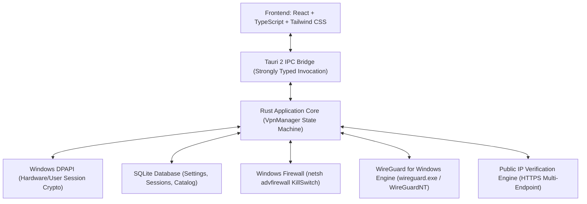

# Private VPN - Architecture Documentation

Private VPN is a high-security, native Windows desktop VPN client built using Tauri 2, Rust, React, TypeScript, and WireGuard.

---

## 1. Architectural Layers

### Frontend Presentation Layer (`src/`)
- **Framework**: React 19 + TypeScript + Vite.
- **Styling**: Tailwind CSS configured with a dark cybersecurity palette (navy `#0B0F19`, charcoal, cyan, and emerald accents) and custom light mode.
- **Components**:
  - `AppHeader`: Real-time status pill, branding, and quick network refresh.
  - `Sidebar`: Section navigation between Dashboard, Locations, Security, Statistics, Diagnostics, and Settings.
  - `ConnectButton`: Interactive central status indicator handling all state transitions.
  - `IpAddressCard`: Displays pre- and post-tunnel public IP comparison, geolocation, and ISP.
  - `StatisticsCard`: Live throughput and transferred data counters.
  - `SecurityStatusCard`: Summary of Kill Switch, DNS, and IPv6 posture.
  - `ServerCard`: Interactive server cards with favorite toggling, ping, and configuration details.

### IPC Command Layer (`src-tauri/src/commands/`)
- Strongly typed command handlers communicating with the frontend.
- Zero shell command exposure to the frontend.
- Strict validation of all inputs in Rust before execution.
- Command modules: `connection`, `servers`, `diagnostics`, `settings`, `statistics`.

### Application State & Lifecycle (`src-tauri/src/vpn/state.rs`)
- Thread-safe `VpnManager` with `Mutex` synchronization.
- Connection states: `Disconnected`, `Connecting`, `Connected`, `Reconnecting`, `Disconnecting`, `Error`.
- Duplicate connection attempt guards preventing race conditions.
- Automatic session duration and traffic rate tracking.

### Secure Storage Layer (`src-tauri/src/storage/` & `security/credentials.rs`)
- **Metadata & Settings**: Stored in a local SQLite database (`%LOCALAPPDATA%\PrivateVPN\private_vpn.db`).
- **Cryptographic Keys**: Client private keys and preshared keys are **never** stored in plain text. They are encrypted using the **Windows Data Protection API (DPAPI)** via native `CryptProtectData` and `CryptUnprotectData` Win32 APIs, binding encryption to the current user's logon credentials.

### Network Verification Layer (`src-tauri/src/network/`)
- Multi-endpoint HTTPS IP detection (ipwho.is, api64.ipify.org, icanhazip.com).
- Verification of IP changes across tunnel transitions without false positives.
- Route table inspection and DNS server address query.

### Security Enforcement Layer (`src-tauri/src/security/firewall.rs`)
- Real Windows Firewall enforcement using `netsh advfirewall`.
- Non-tunnel traffic block rule (`PrivateVPN-KillSwitch-BlockAll`).
- Handshake exception rules for the authorized VPN endpoint.
- Emergency cleanup and fail-safe reset functions to guarantee user connectivity recovery.
